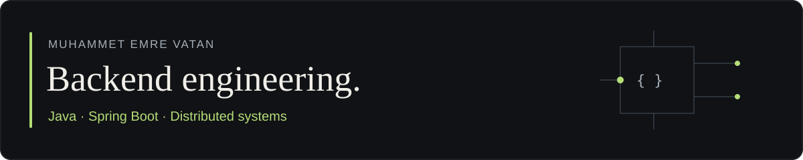

I'm a **Backend Software Engineer** working with **Java, Spring Boot, and distributed systems**. I build APIs, asynchronous integrations, and data processing services, with an emphasis on maintainable code, data consistency, and reliable operation.

[Portfolio](https://muhammetemrevatan.com/?lang=en) · [Technical writing](https://muhammetemrevatan.com/blog?lang=en) · [LinkedIn](https://www.linkedin.com/in/muhammetemrevatan/)

## Engineering focus

- **Backend:** Java, Spring Boot, Spring Batch; modular services and HTTP APIs.
- **Messaging & data:** Kafka, RabbitMQ, Redis, PostgreSQL, and Oracle; event-driven integration and relational data processing.
- **Reliability:** Transactional Outbox, idempotent event processing, and testing with JUnit and Mockito.
- **AI & retrieval:** Exploring Retrieval-Augmented Generation (RAG) architectures, embeddings, vector search, and LLM integrations.

Alongside backend development, I build personal automations with **Python and n8n**, and deploy my projects with **Docker and Dokploy**. My [daily AI news digest](https://muhammetemrevatan.com/projects/daily-ai-news-digest?lang=en) combines RSS sources, Gemini summarization, and Telegram delivery.

Project explanations, workflow diagrams, and development notes live on [muhammetemrevatan.com](https://muhammetemrevatan.com/?lang=en).

